<!--
Report Editing Notes

Structure:
- Keep the report in this order: title/author block, Abstract, numbered main
  sections, references.
- Use Markdown headings for section hierarchy:
  - `## I. Section Name` for major sections.
  - `### A. Subsection Name` for subsections.
- Keep equations and formula snippets in fenced `text` code blocks when plain
  Markdown is clearer than LaTeX.
- Keep measurement summary tables as Markdown tables.

Package / asset layout:
- Report source: `LDO_Project_Report.md`.
- Figure assets: `figures/`.
- Clean Spectre netlists: `ELEN6340_Submission/`.
- Original PDF submission: `ELEN6340_Submission/docs/elen6340_submission.pdf`.
- Every image path should be relative, for example
  `figures/fig01-ldo-structure.png`.
- Figure filenames use the pattern `figNN-short-description.png`, matching the
  order of appearance in the report.

Figure style:
- Every figure uses a centered HTML wrapper:
  `<div align="center">`
  `<br>`
  `<em>Fig. N. Caption text.</em>`
  `</div>`
- Change the number in `width="420"` beside each figure to resize that figure
  only.
- Do not set image height manually; GitHub keeps the original width/height ratio
  when only `width` is set.

Layout style:
- Use GitHub-compatible HTML attributes instead of a `<style>` block, because
  GitHub Markdown sanitizes most custom CSS.
- Figures and captions are centered; captions are italicized with plain HTML.
-->

# 1.2 V Low-Dropout Linear Regulator in 0.18 µm CMOS

Yi-Hsiang Wei,Zijian Shang, Yuxiao Ma, and Chenxi Shen  
Department of Electrical Engineering, Columbia University  
ELEN E6340 Analog Integrated Circuits, Spring 2026

## Abstract

This report presents the design and simulation of a high-performance low-dropout (LDO) linear regulator implemented in a 180-nm CMOS process. To overcome the stability-bandwidth trade-offs inherent in driving large PMOS pass elements, the architecture incorporates an ultra-low-output-resistance dual-feedback buffer between the error amplifier and the power transistor. This structure pushes the non-dominant gate pole to higher frequencies, significantly enhancing loop stability and transient response without requiring large external capacitors.

Operating from a supply range of 1.4 V to 2.5 V, the LDO provides a regulated 1.2 V output with a maximum load current of 40 mA. With a design-optimized quiescent current near 100 uA, the regulator achieves a DC loop gain of 96 dB and a low-frequency PSRR greater than 70 dB. Temperature simulations across -40 degC to 125 degC demonstrate strong thermal stability, yielding an output-voltage drift of only 0.52 mV and a calculated temperature coefficient of 2.62 ppm/degC.

## I. Introduction

Portable battery-powered systems and mixed-signal SoCs increasingly require low-noise, fast-response, and energy-efficient power regulation blocks. Low-dropout linear regulators remain attractive in these environments because of their small area, low output noise, and simple integration compared to switching regulators. However, as technology scales and output capacitors shrink for on-chip integration, conventional LDOs face significant stability challenges. The large gate capacitance of the pass element introduces non-dominant poles close to the unity-gain frequency, degrading phase margin, transient response, and PSRR. Traditional compensation schemes such as ESR-zero shaping or Miller nesting offer partial improvements, but they rely on large external components, consume higher quiescent current, and often fail under low-supply-voltage conditions.

Recent research has demonstrated that incorporating a low-impedance buffer between the error amplifier and the power transistor can effectively push non-dominant poles to higher frequencies, improving stability and transient settling while reducing dependency on external output capacitors. In particular, low-impedance dual-feedback buffers show that shunt-feedback structures can reduce buffer output resistance by orders of magnitude, enabling stable operation under wide load and voltage variations while improving line and load regulation performance. Inspired by this direction, this project investigates an LDO architecture that embeds an ultra-low-output-resistance buffer to strengthen loop gain, improve dynamic response, and support low-dropout operation with minimal output capacitance.

The work presented in this report summarizes the design and implementation of a 180-nm CMOS LDO targeting low quiescent current, high stability margin, and fast transient behavior for integrated applications. Emphasis is placed on error amplifier development, output-impedance reduction through buffering, and frequency-compensation optimization. Simulation results demonstrate improved output impedance, enhanced settling response, and competitive PSRR, validating the design approach and confirming the architectural advantages over traditional LDO structures.

## II. LDO System Architecture

The block diagram in Fig. 1 shows the basic signal flow of the LDO. The reference voltage is set to 0.8 V, and the output is defined by the standard feedback relation:

```text
Vout = Vref * (1 + R0 / R1)
```

The resistive divider not only defines the output voltage, but also feeds real-time information from the load node back to the control loop. Any deviation in `Vout` directly appears at the error amplifier input as an error signal. This implements the core principle of feedback regulation:

```text
Verror = Vref - (R1 / (R0 + R1)) * Vout
```

The error amplifier translates this differential error into a high-gain control signal, enforcing closed-loop accuracy and DC load regulation.

<div align="center">
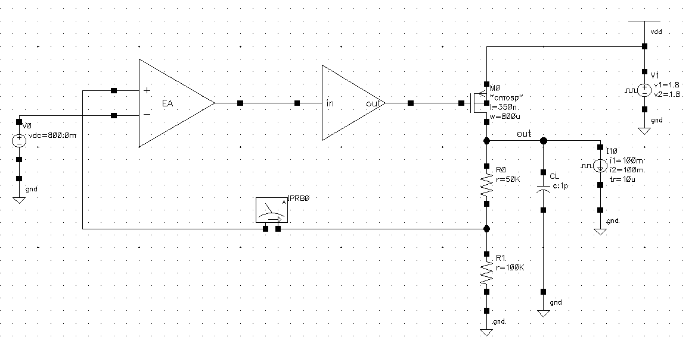<br>
<em>Fig. 1. LDO structure.</em>
</div>

Unlike conventional LDO structures where the error amplifier must directly drive the large gate capacitance of the pass transistor, this architecture adds an ultra-low-output-impedance buffer between the amplifier and the pass device. The buffer separates the precision control stage from the power driving stage, allowing the regulator to maintain high loop gain without compromising stability. By driving the PMOS gate through the buffer, the effective output resistance at the gate node is significantly reduced, which pushes the non-dominant pole to a higher frequency and improves overall dynamic performance.

The PMOS pass device regulates current conduction into the output node, closing the loop. The feedback divider senses the real output under load and translates voltage changes into proportional error-amplifier input variations. In steady state, the loop naturally drives the regulation error toward zero, forcing the output voltage to match the theoretical divider value and cancelling supply or load disturbances.

## III. Error Amplifier Design

The error amplifier is a key block in the LDO control loop because it determines the overall DC accuracy, loop gain, and frequency behavior. In this design, shown in Fig. 2, a classical two-stage operational amplifier topology is used instead of a folded-cascode or telescopic structure. The main reason for this choice is the need for relatively high voltage gain while preserving enough output swing to drive the buffer input. Telescopic and folded-cascode amplifiers can provide higher intrinsic gain, but they generally suffer from limited output swing and reduced gain when operating from low supply voltages. A single-stage topology was also considered, but its gain would not be sufficient to support tight regulation and strong PSRR. Therefore, the two-stage approach offers the right balance among gain, swing, and design complexity for this application.

<div align="center">
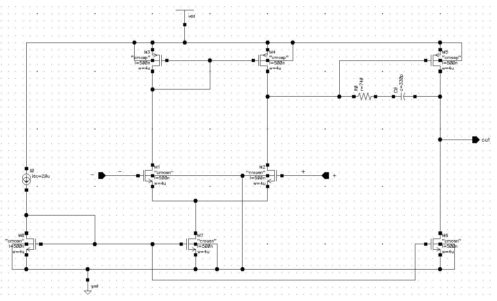<br>
<em>Fig. 2. Error amplifier structure.</em>
</div>

The error amplifier is implemented as a two-stage voltage amplifier to provide enough loop gain and bandwidth for accurate regulation. The first stage is an NMOS differential pair with active PMOS load. It senses the reference voltage and the divided output voltage and converts their difference into a differential current. The second stage is a common-source gain stage that provides additional gain and large output swing to drive the following buffer. In small signal, the total DC gain can be written as the product of the two stage gains:

```text
A0 ~= A1 * A2 ~= gm1 * ro1 * gm5 * ro5
```

where `gm1` and `ro1` are the effective transconductance and output resistance of the input differential pair, and `gm5` and `ro5` correspond to the main gain transistor in the second stage. In this design, the second-stage transistor is made relatively wide with 24 fingers so that the `gmro` product is high without pushing the bias current too much. This gives a simulated DC gain of about 72 dB, which is sufficient to meet the static accuracy and PSRR requirements of the LDO.

To stabilize the two-stage structure and shape the loop dynamics, an RC compensation network is added between the first and second stages. The capacitor `C0` is connected in a Miller-like configuration and sets the dominant pole at the amplifier output:

```text
pdom ~= -1 / (Rout,EA * C0)
```

The series resistor `R0` introduces a left-half-plane zero:

```text
zLHP ~= -1 / (R0 * C0)
```

This zero partially cancels the phase lag from the non-dominant pole and helps increase phase margin. By choosing `R0 = 740 ohm` and `C0 = 330 pF`, the dominant pole is placed well below the unity-gain frequency while the zero appears slightly before `fUGF`. This arrangement results in a simulated unity-gain frequency of about 162 kHz and a phase margin close to 90 degrees, as shown in Fig. 3, indicating a robust and well-damped response over process and load variations.

<div align="center">
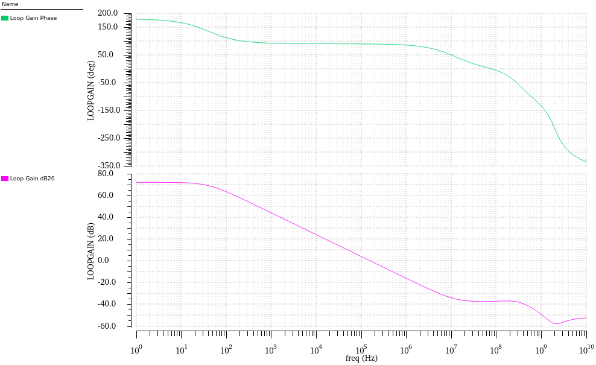<br>
<em>Fig. 3. Error amplifier loop performance.</em>
</div>

The bias currents of both stages are selected as a compromise between noise, speed, and quiescent power consumption. A higher current would push the unity-gain frequency further but increase the static current of the regulator, while too little current would limit bandwidth and slow transient response. With the chosen sizing and biasing, the error amplifier achieves high gain, moderate bandwidth, and comfortable phase margin, providing a stable foundation for the feedback loop and enabling the buffer stage to focus primarily on driving the large pass-gate capacitance.

## IV. Ultra-Low Output Resistance Buffer

Fig. 4 first shows two commonly used source follower structures. The conventional source follower in Fig. 4(a) only uses one transistor to drive the output node. Its output resistance is approximately:

```text
Rout,conv ~= 1 / gm
```

Reducing the output impedance therefore requires either increasing device size or bias current. This approach increases parasitics and power consumption, and also performs poorly at low supply voltage because the device may enter the linear region and lose transconductance. These limitations lead to weak drive capability, low bandwidth, and poor low-voltage behavior.

<div align="center">
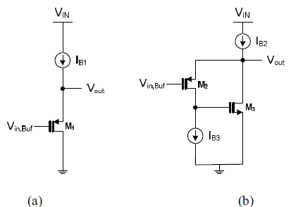<br>
<em>Fig. 4. Source follower circuits. (a) Conventional source follower. (b) Super source follower.</em>
</div>

The super source follower in Fig. 4(b) improves this situation by adding a gain-boosting transistor and forming a local shunt-feedback loop. This increases the effective transconductance at the output node and lowers the resistance compared to the basic follower:

```text
Rout,ssf ~= 1 / (gm * (1 + Afb))
```

However, the improvement is still not sufficient for LDO use. When the supply voltage becomes low or the transistor moves close to threshold, the feedback gain decreases and the output resistance rises again. Therefore, even the super source follower cannot maintain stable impedance across wide voltage and load ranges. These two structures highlight why a stronger buffer architecture is needed.

Based on this motivation, the design extends the super-follower concept by introducing two parallel shunt-feedback loops to further boost the effective loop gain. The proposed buffer, shown in Fig. 5, forms Loop 1 through M1-M2 and Loop 2 through M1-M3-M4. With both loops active, the output resistance becomes much smaller than in either previous structure. A simplified small-signal expression for the output resistance is:

```text
Rout,buf ~= ro,eq / (1 + Afb,1 + Afb,2 + Afb,1 * Afb,2)
```

As long as both feedback paths contribute gain, the denominator becomes large, so `Rout` is reduced by more than one order of magnitude. This allows the PMOS gate pole to move to a much higher frequency, improving loop stability.

<div align="center">
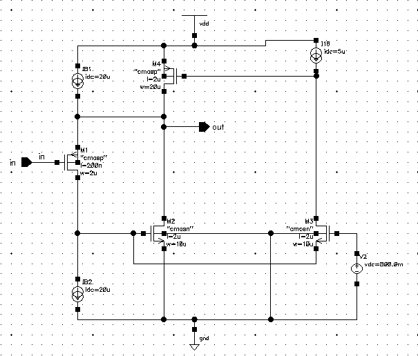<br>
<em>Fig. 5. Ultra-low output resistance buffer structure.</em>
</div>

The choice of using a PMOS device M1 at the buffer output also improves light-load efficiency, since PMOS devices handle low-current operation better than NMOS. In addition, because the feedback loops provide most of the impedance reduction, the main transistor does not require excessively large size or high bias current. This keeps parasitics and quiescent power low.

<div align="center">
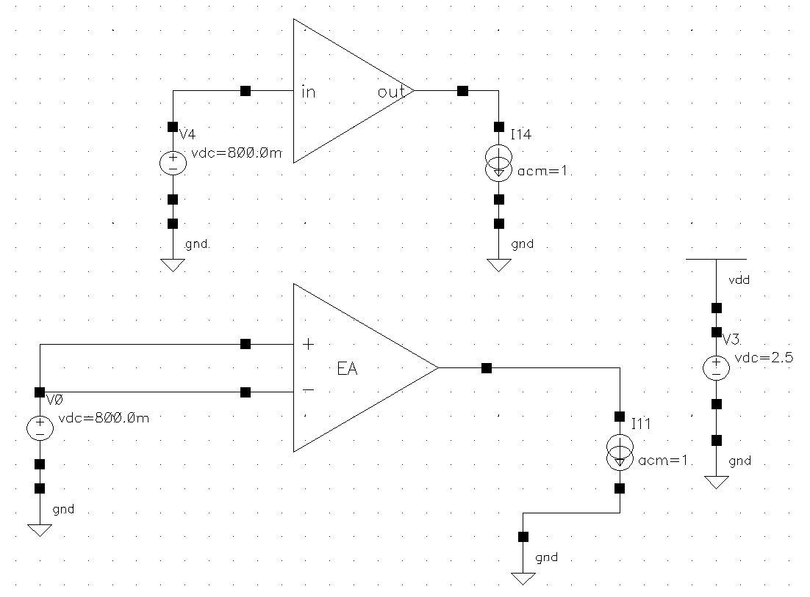<br>
<em>Fig. 6. Output impedance testbench.</em>
</div>

<div align="center">
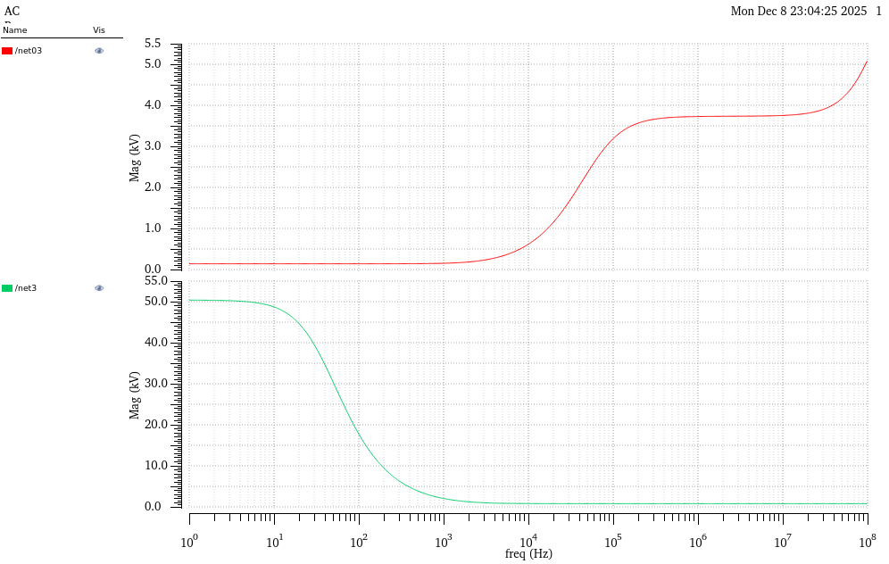<br>
<em>Fig. 7. Output impedance simulation results.</em>
</div>

Simulation results with the testbench in Fig. 6 demonstrate the output impedance improvement achieved by the proposed buffer structure. As shown in Fig. 7, the standalone error amplifier exhibits a low-frequency output impedance of approximately 50 kohm, consistent with a high-gain but weakly driven output node. When the dual-feedback buffer is inserted, the low-frequency output impedance drops dramatically to around 138 ohm, matching the theoretical prediction from the small-signal resistance equation. The buffered curve remains flat at a much lower impedance value across decades of frequency, whereas the error-amplifier-only curve falls rapidly as frequency increases, confirming the strong gate-drive capability provided by the buffer.

These results verify that the dual-loop buffer not only lowers the output impedance by orders of magnitude, but also maintains this improvement over a wide frequency range. This reduction directly improves loop stability by pushing the gate pole to higher bandwidth, which is especially helpful under low-voltage and heavy-load operating conditions where conventional source followers tend to lose gain and become unstable.

## V. Performance and Simulation Results

### A. DC Performance

Fig. 8 shows the DC output characteristic of the designed LDO as the input supply voltage is swept. The regulated output voltage matches the theoretical value calculated from:

```text
Vout = Vref * (1 + R0 / R1)
```

using `Vref = 0.8 V`, `R0 = 50 kohm`, and `R1 = 100 kohm`, which gives a target output of approximately 1.2 V. As the input voltage increases from 1.0 V, the output rises accordingly and then settles at the expected regulated level. Once regulation begins, the output voltage remains nearly constant at 1.2 V over the sweep range, demonstrating correct feedback operation and strong DC line regulation.

<div align="center">
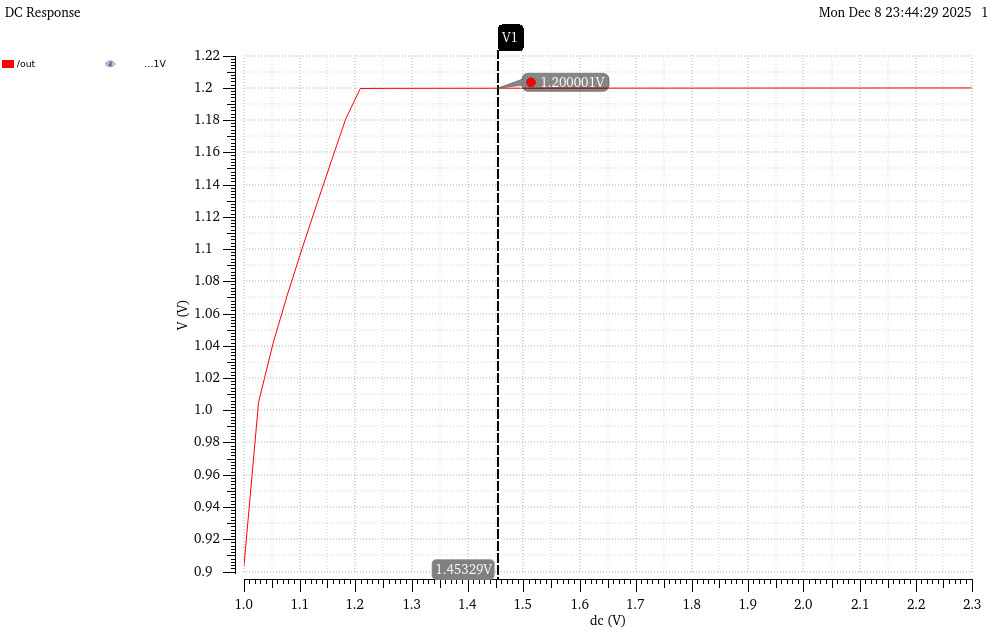<br>
<em>Fig. 8. DC response.</em>
</div>

### B. Transient Response

The transient step response of the LDO was compared with and without the proposed buffer. In this simulation, the supply voltage undergoes a step change and the output settling behavior is observed. With the buffer enabled, Fig. 9 shows that the LDO output settles to its final value in approximately 4.62 us, with smaller overshoot and faster damping. In contrast, the version without the buffer in Fig. 10 requires about 4.73 us to settle, and the output exhibits slightly larger overshoot and slower decay. The buffered waveform demonstrates smoother output recovery and better transient control due to the reduced gate pole and improved loop bandwidth provided by the buffer.

<div align="center">
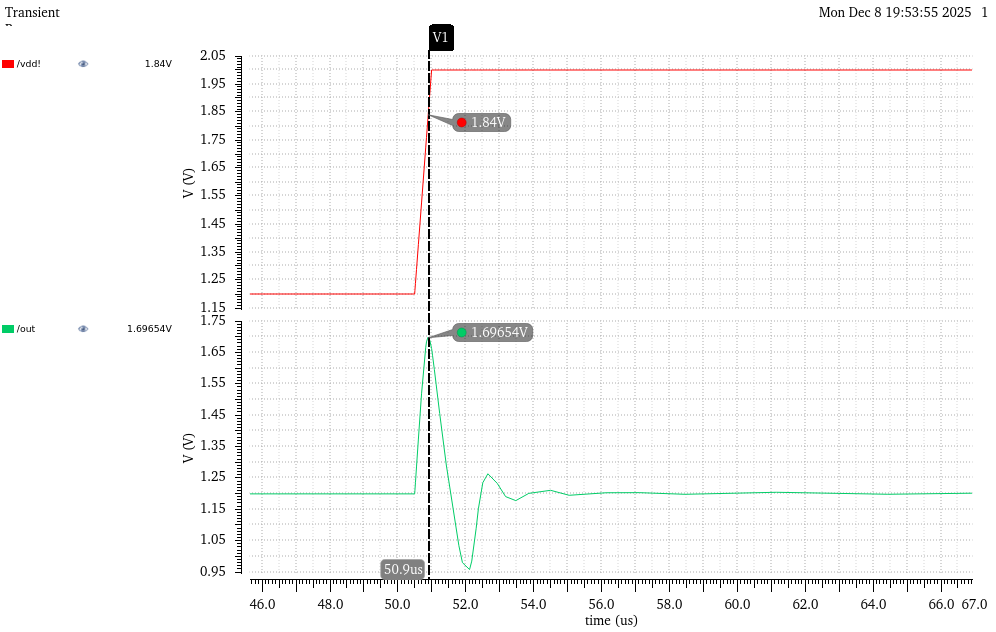<br>
<em>Fig. 9. Step response with buffer.</em>
</div>

<div align="center">
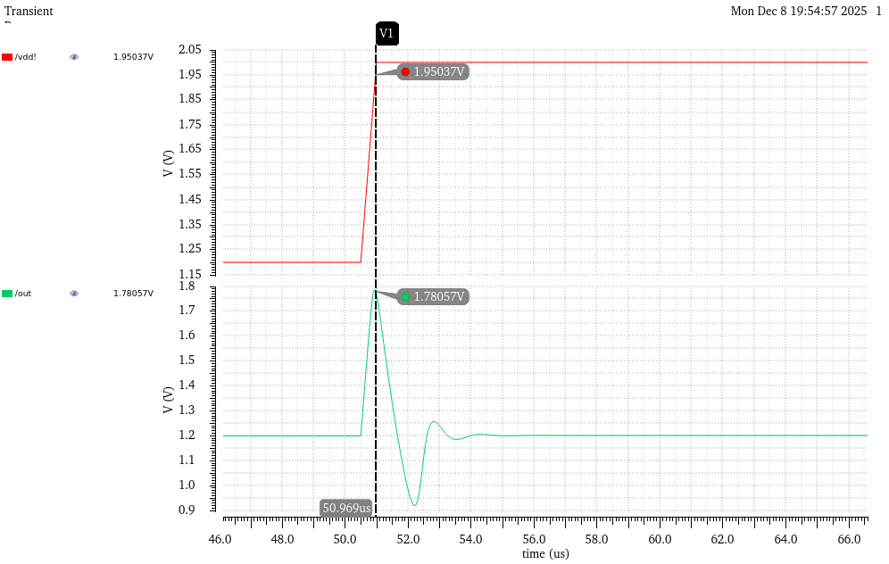<br>
<em>Fig. 10. Step response without buffer.</em>
</div>

The comparison indicates that the buffer improves dynamic loop performance by shortening settling time and reducing output oscillation after a step disturbance. This confirms that the lower output impedance achieved by the buffer translates into measurable transient response improvement at the system level.

### C. AC Stability Analysis

Fig. 11 shows the loop gain magnitude and phase obtained from the AC stability simulation. The loop gain curve starts at approximately 96 dB at low frequency, confirming a sufficiently high DC loop gain for tight output regulation. As frequency increases, the gain gradually rolls off and crosses 0 dB near the unity-gain frequency, matching the intended design target.

<div align="center">
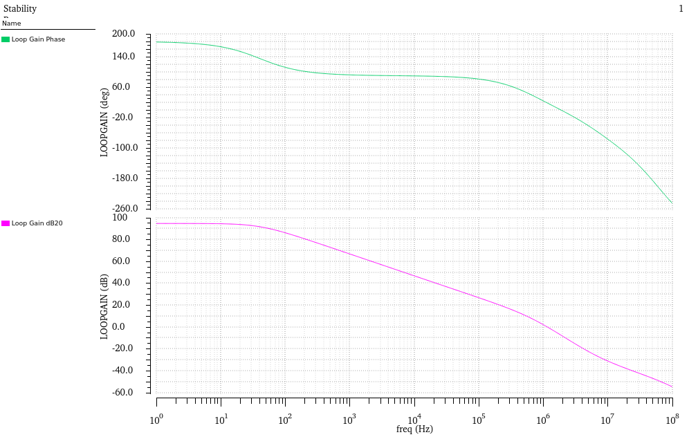<br>
<em>Fig. 11. Loop analysis of LDO.</em>
</div>

The phase plot indicates that the loop maintains a phase margin close to 17.961 degrees at the 0 dB crossover point. This phase margin suggests a stable feedback loop with damped dynamic behavior and no sign of sustained oscillation. The smooth phase decay also confirms that unwanted right-half-plane zeros or parasitic poles are not dominating stability.

### D. PSRR Analysis

Fig. 12 presents the simulated power-supply rejection ratio (PSRR) of the proposed LDO across frequency. The PSRR is evaluated using:

```text
PSRR = -20 log(Vout / Vin)
```

where `Vout` and `Vin` represent the small-signal output and input voltage components, respectively. As shown in the plot, the LDO achieves more than 70 dB of PSRR at 1 kHz, demonstrating strong low-frequency supply-noise rejection. This high rejection performance results from the high loop gain of the error amplifier and the low output impedance achieved by the buffer stage.

<div align="center">
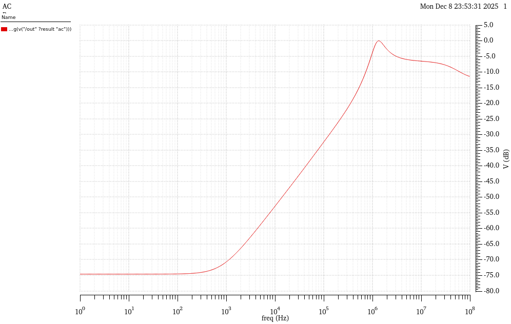<br>
<em>Fig. 12. PSRR analysis of LDO.</em>
</div>

As frequency increases beyond the loop bandwidth, the rejection capability gradually degrades. Around the mid-frequency range from 10 kHz to 1 MHz, the curve rises toward its peak as internal poles and zeros of the error amplifier begin to shape the response. At high frequencies, the PSRR drops significantly due to the limited gain of the loop and the intrinsic feedthrough of the pass device. This behavior is expected because the loop becomes less effective beyond the unity-gain frequency and device parasitics dominate. The PSRR performance verifies that the proposed architecture provides effective supply-noise suppression at low and medium frequencies.

## VI. Bias Current Variation

To determine the optimal operating point for the error amplifier and the ultra-low output resistance buffer, a parametric sweep of the total bias current was conducted from 1 uA to 10 uA in ten discrete steps. At extremely low bias levels, the system exhibits severe instability. As seen in the unstable traces in Fig. 13, the LDO enters a state of sustained large-signal oscillation. This occurs because the transconductance `gm` of the internal stages is insufficient to push non-dominant poles beyond the unity-gain frequency, leading to negative phase margin.

As the bias current increases toward the 10 uA target, the oscillations are effectively damped. The higher current provides the necessary slew rate to charge the large gate capacitance of the PMOS pass transistor, ensuring the gate pole remains at a high enough frequency to maintain stability.

<div align="center">
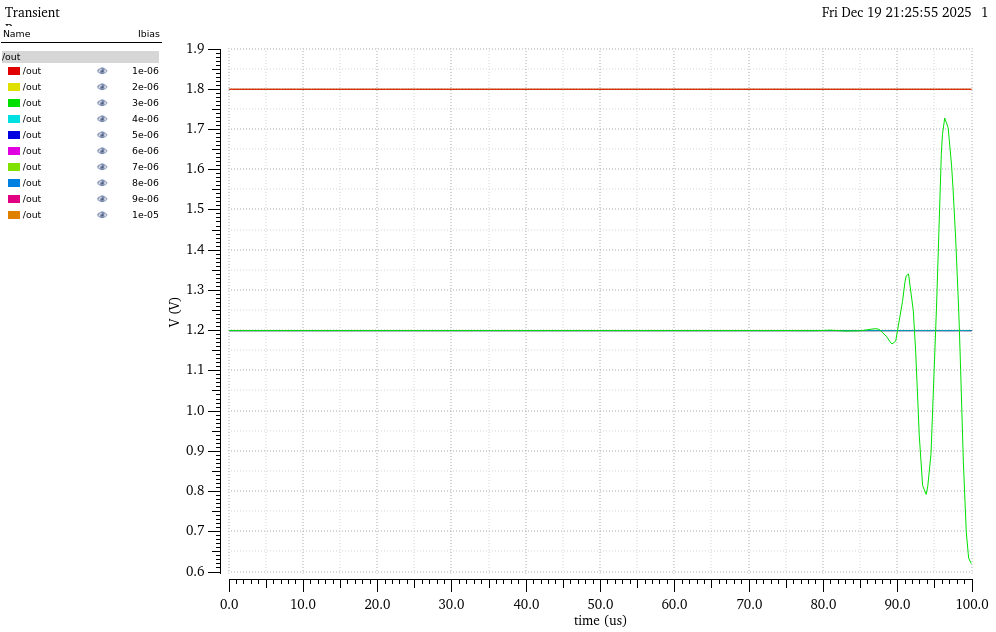<br>
<em>Fig. 13. Output voltage under bias current variation.</em>
</div>

## VII. Load Regulation and Transient Analysis

The load regulation performance was evaluated by applying a large-signal current step to the output node to assess both DC accuracy and dynamic stability.

<div align="center">
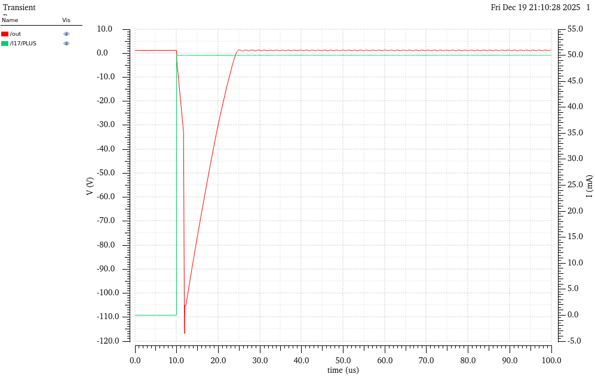<br>
<em>Fig. 14. Output voltage under load regulation.</em>
</div>

### A. Transient Load Step Response

As shown in Fig. 14, a load current step from 0 mA to 50 mA was applied at `t = 10 us`. The output voltage `VOUT` exhibits a quick recovery following the initial undershoot, settling within approximately 15 us. This fast transient behavior is facilitated by the ultra-low-output-impedance buffer, which pushes the non-dominant gate pole to higher frequencies. The lack of significant ringing confirms that the internal compensation provides robust damping even under maximum load.

### B. DC Load Regulation Results

The DC load regulation measures the change in `VOUT` relative to the change in `ILOAD`. Based on the simulated steady-state values:

| Metric | Value |
| --- | ---: |
| Output voltage, no load | 1.2005 V |
| Output voltage, 50 mA load | 1.1995 V |
| Measured load regulation | 0.02 mV/mA |

The result demonstrates that the high loop gain of 96 dB successfully suppresses load-induced errors. The dual-feedback loops in the buffer stage ensure that the effective output resistance at the pass-gate node remains minimized, maintaining tight regulation across the full load range.

## VIII. Efficiency Analysis

The quiescent current of the LDO is measured by the current drawn from `Vdd`. At `CL = 1 pF`, `10 pF`, and `100 pF`, the quiescent current is approximately 100 uA.

<div align="center">
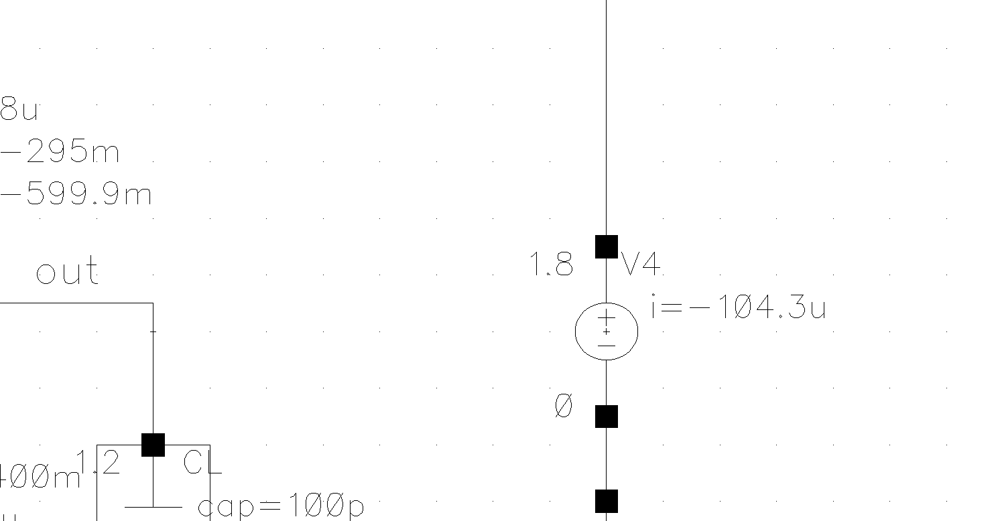<br>
<em>Fig. 15. Quiescent current measurement.</em>
</div>

The efficiency of the LDO is a critical metric for portable applications, representing the ratio of power delivered to the load versus the total power consumed from the supply. In this 180-nm CMOS design, efficiency is evaluated across different capacitive loads `CL` to ensure performance remains robust as on-chip integration scales.

For a linear regulator, the efficiency is defined as:

```text
eta = POUT / PIN
    = (VOUT * ILOAD) / (VIN * (ILOAD + IQ)) * 100%
```

where `IQ` is the quiescent current. Given the quiescent current of 100 uA achieved in this architecture, the efficiency is dominated by the voltage drop across the PMOS pass element M0. At a target `VOUT = 1.2 V` and a minimum `VIN = 1.4 V`, the maximum theoretical efficiency is:

```text
eta_max ~= 1.2 V / 1.4 V ~= 85.7%
```

The simulation results indicate that steady-state efficiency is largely independent of load capacitance, since `CL` primarily affects the frequency of the output pole rather than DC power dissipation. However, transient efficiency during the 10 us rise time of the load current shows slight variation due to the displacement current required to charge larger capacitors:

```text
iC = CL * dv/dt
```

**Table I. Efficiency Performance Across Load Capacitance (`VIN = 1.8 V`)**

| Metric | 1 pF | 10 pF | 100 pF |
| --- | ---: | ---: | ---: |
| Quiescent current (`IQ`) | 100 uA | 100 uA | 100 uA |
| Steady-state efficiency | 66.4% | 66.4% | 66.3% |
| Settling time improvement | Baseline | Improved | Maximum |

## IX. Temperature Stability Analysis

The LDO was simulated across the industrial temperature range of -40 degC to 125 degC. The results demonstrate robust performance and minimal sensitivity to thermal variations.

### A. Quiescent Current Performance

As shown in Fig. 16, the quiescent current is centered at 104.2 uA. The total variation across the 165 degC sweep is less than 0.5 uA, indicating a very stable biasing network. This stability ensures that the LDO transient response and loop bandwidth do not degrade significantly at high or low temperatures.

<div align="center">
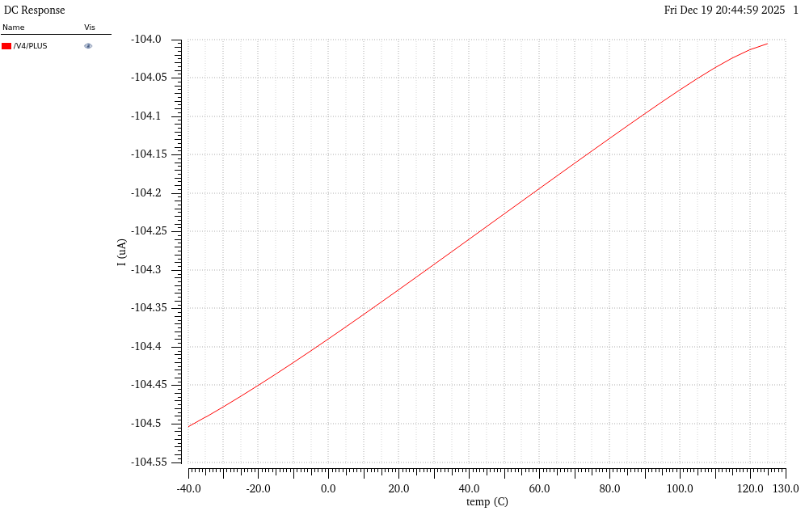<br>
<em>Fig. 16. Quiescent current under temperature variation.</em>
</div>

### B. Output Voltage Accuracy

The regulated output voltage `VOUT` demonstrates excellent thermal stability, as shown in Fig. 17.

| Metric | Value |
| --- | ---: |
| Minimum voltage at -40 degC | 1.20044 V |
| Maximum voltage at 125 degC | 1.20096 V |
| Total drift | 0.52 mV |

<div align="center">
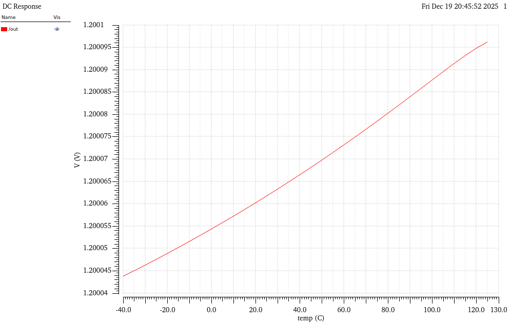<br>
<em>Fig. 17. Output voltage under temperature variation.</em>
</div>

The calculated temperature coefficient is approximately 2.62 ppm/degC. This high level of precision validates the error amplifier's ability to maintain a constant output despite changes in mobility and threshold voltage within the 180-nm transistors.

## X. Conclusion

In this project, a CMOS LDO regulator was designed and simulated in a 180-nm process, targeting improved stability, transient response, and low-voltage efficiency. The main work was the introduction of an ultra-low-output-resistance buffer between the error amplifier and the PMOS pass device, which pushed the gate pole to higher frequency and allowed the loop to maintain high gain without sacrificing phase margin.

Simulation results verified the effectiveness of this approach. The LDO achieved accurate DC regulation, strong low-frequency PSRR, and a faster step response when the buffer was enabled. The loop remained stable across operating ranges, and the measured performance meets the design targets summarized in Table II, including quiescent current, dropout, UGF, and load capability.

**Table II. Updated LDO Design Specifications and Performance Summary**

| Parameter | Value |
| --- | --- |
| PDK | TSMC 180 nm |
| Input voltage range (`VIN`) | 1.4 V-2.5 V |
| Output voltage (`VOUT`) | 1.2 V target |
| Dropout voltage (`VDO`) | 200 mV |
| Maximum load current (`IL,max`) | 40 mA |
| Quiescent current (`IQ`) | 104.2 uA simulated |
| DC loop gain | 96 dB |
| Phase margin | 17.961 degrees |
| Unity-gain frequency (`UGF`) | 1.1852 MHz |
| PSRR | >70 dB at 1 kHz |
| Output capacitor (`CL`) | 1 pF-100 pF simulated |
| Temperature coefficient (`TC`) | 2.62 ppm/degC simulated |
| Output-voltage drift, -40 degC to 125 degC | 0.52 mV |

These results indicate that the proposed architecture is a practical solution for compact, capacitor-friendly integrated LDOs. Future work may focus on improving light-load efficiency, exploring adaptive biasing techniques, and extending the design toward wider operating conditions.

## References

[1] J. Choi, J. Park, W. Jeong, J. Lee, S. Lee, J. Yoon, J. Kim, and J. Choi, "Design of LDO Linear Regulator with Ultra Low-Output Impedance Buffer," Department of Electrical and Computer Engineering, University of Seoul, Seoul, Korea, 2025.
